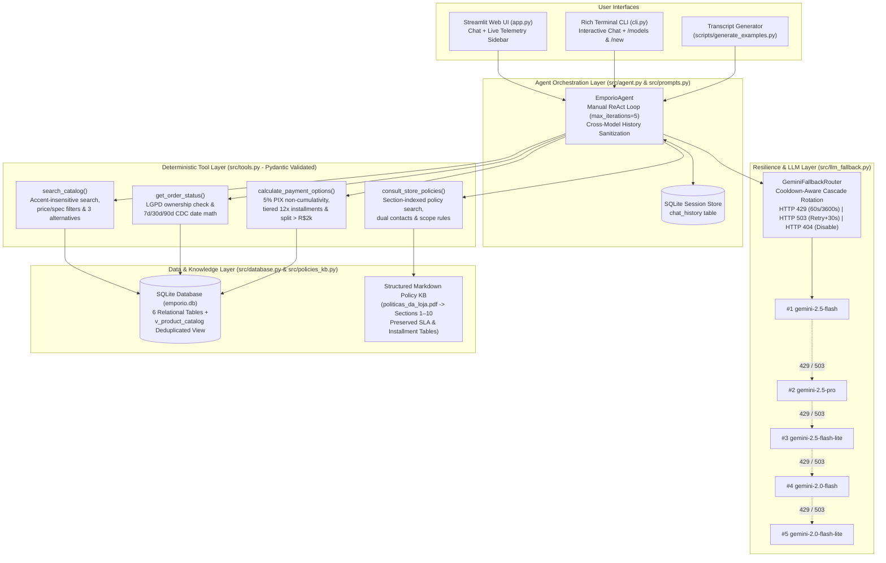

# 🎸 Empório da Música — AI Customer Support Agent

[](https://www.python.org/)
[](https://pypi.org/project/google-genai/)
[](https://www.sqlite.org/)
[](https://streamlit.io/)
[-brightgreen?logo=pytest)](https://docs.pytest.org/)

> **Technical Case Assessment — AI Engineer (Full-Stack para Aplicações com IA Generativa)**  
> **Candidate:** Olmir Stocker Neto  
> **Repository:** [`https://github.com/owmyr/Artefact`](https://github.com/owmyr/Artefact)

> 🇧🇷 **Nota de Idioma / Language Note:** This documentation is structured primarily in **English** to satisfy the technical assessment instructions, followed by a complete **Brazilian Portuguese (`pt-BR`) Quick-Start & Executive Summary** ([jump to Portuguese section](#-resumo-executivo-e-guia-rápido-pt-br)). The agent itself interacts exclusively in natural Brazilian Portuguese (`pt-BR`).

---

## 📑 Table of Contents

1. [Project Overview & System Architecture](#1-project-overview--system-architecture)
2. [Environment Setup & Execution Instructions](#2-environment-setup--execution-instructions)
3. [Justification of Technical Decisions](#3-justification-of-technical-decisions)
   - [3.1 Agent Framework & Approach (Deterministic ReAct vs. Naive RAG vs. Text-to-SQL)](#31-agent-framework--approach-deterministic-react-vs-naive-rag-vs-text-to-sql)
   - [3.2 LLM Provider & Multi-Model Free-Tier Fallback Router (`src/llm_fallback.py`)](#32-llm-provider--multi-model-free-tier-fallback-router-srcllm_fallbackpy)
   - [3.3 Policy Retrieval Strategy (`src/policies_kb.py`)](#33-policy-retrieval-strategy-srcpolicies_kbpy)
   - [3.4 Data Treatment & Documented Assumptions (EDA Findings)](#34-data-treatment--documented-assumptions-eda-findings)
4. [Known Limitations & Production Roadmap (With More Time)](#4-known-limitations--production-roadmap-with-more-time)
5. [Use of AI Coding Assistants (Engineering Workflow)](#5-use-of-ai-coding-assistants-engineering-workflow)
6. [🇧🇷 Resumo Executivo e Guia Rápido (pt-BR)](#-resumo-executivo-e-guia-rápido-pt-br)

---

## 1. Project Overview & System Architecture

**Empório da Música** (*"Sua música começa aqui"*) is a traditional musical instrument store founded in 2008 and located in **Campo Grande/MS** (*Rua 14 de Maio, 3200 — Centro, CEP 79202-333*). This project delivers a production-grade, zero-hallucination **Stateful ReAct Customer Support Agent** designed to automate the store's WhatsApp and web customer service channels.

The agent assists beginner, intermediate, and professional musicians in **Brazilian Portuguese (`pt-BR`)** across four core workflows:
1. **Catalog Discovery & Technical Consulting:** Filtering instruments by category, budget, wood specifications, string types, and pickup electronics while enforcing strict availability rules (`status == 'active' AND stock_quantity > 0`) and proactively suggesting up to 3 in-stock alternatives whenever an item is out of stock, discontinued, coming soon, or in an empty category.
2. **Financial & Installment Simulation:** Computing 5% PIX discounts (enforcing non-cumulativity with active promotions), active vs. expired promotional campaigns, tiered interest-free credit card installments (up to 12x), and split payments (*entrada no PIX + Cartão*) for purchases above R$ 2,000.00.
3. **LGPD-Compliant Order Tracking & CDC Deadlines:** Verifying customer ownership (`order_id` + Name/Email/Phone) before disclosing tracking codes and deterministically calculating statutory return, defect exchange, and warranty windows against the purchase and delivery dates.
4. **Store Policies, Shipping SLAs & Scope Guardrails:** Answering questions on store hours, dual contact channels, local motoboy vs. national carrier SLAs (PAC, SEDEX, Jadlog), and politely refusing out-of-scope requests for standalone musical accessories (strings, picks, cables, cases, pedals, amplifiers) or unrelated topics.

### System Architecture Diagram



### Canonical Repository Structure

```text
.
├── AGENTS.md                     # Architectural specification & business logic invariants
├── README.md                     # Project documentation (EN primary + PT-BR quick-start)
├── requirements.txt              # Pinned Python 3.11+ dependencies
├── .env.example                  # Template for GEMINI_API_KEY and model cascade
├── app.py                        # Streamlit Chat UI with real-time telemetry sidebar
├── cli.py                        # Rich interactive terminal chat interface
├── data/                         # Raw store dataset (6 CSVs + 8-page PDF manual)
│   ├── categories.csv
│   ├── customers.csv
│   ├── order_items.csv
│   ├── orders.csv
│   ├── products.csv
│   ├── promotions.csv
│   └── politicas_da_loja.pdf
├── src/
│   ├── __init__.py
│   ├── config.py                 # Environment configuration & Gemini model cascade
│   ├── database.py               # SQLite schema ingestion & v_product_catalog view
│   ├── policies_kb.py            # Section-preserved Markdown policy knowledge base
│   ├── tools.py                  # Deterministic Pydantic-typed agent tools
│   ├── llm_fallback.py           # Gemini Free-Tier multi-model fallback router
│   ├── prompts.py                # System prompt, pt-BR persona, and guardrails
│   └── agent.py                  # Stateful ReAct loop + SQLite session persistence
├── scripts/
│   ├── generate_examples.py      # Generates the 5 multi-turn markdown transcripts
│   └── export_submission_pdf.py  # Compiles executive summary + examples into submission PDF
├── examples/                     # 5 multi-turn conversation logs with tool telemetry
│   ├── 01_catalogo_violoes_ate_1000.md
│   ├── 02_preco_promocao_expirada_parcelamento.md
│   ├── 03_politica_devolucao_e_status_pedido.md
│   ├── 04_informacoes_gerais_e_frete.md
│   └── 05_fora_de_escopo_acessorios_e_guardrails.md
└── tests/                        # Comprehensive pytest suite (35 unit & integration tests)
    ├── test_database.py
    ├── test_policies.py
    ├── test_tools.py
    └── test_fallback.py
```

---

## 2. Environment Setup & Execution Instructions

### Prerequisites
- **Python 3.11+**
- A free **Google AI Studio API Key** (`GEMINI_API_KEY`) — obtainable at [aistudio.google.com/apikey](https://aistudio.google.com/apikey).

### Step 1: Clone the Repository & Create a Virtual Environment

```bash
git clone https://github.com/owmyr/Artefact.git
cd Artefact

python3 -m venv .venv
source .venv/bin/activate  # On Windows: .venv\Scripts\activate
pip install --upgrade pip
pip install -r requirements.txt
```

### Step 2: Configure Environment Variables (`.env`)

Copy the provided `.env.example` template to `.env` and insert your Google AI Studio API key:

```bash
cp .env.example .env
```

Edit `.env`:

```dotenv
# Google AI Studio API Key
GEMINI_API_KEY=your_google_ai_studio_key_here

# Prioritized Gemini Model Fallback Cascade (comma-separated)
GEMINI_MODELS=gemini-2.5-flash,gemini-2.5-pro,gemini-2.5-flash-lite,gemini-2.0-flash,gemini-2.0-flash-lite
```

> **Note:** The SQLite database (`emporio.db`) is automatically initialized and seeded from `data/*.csv` on first import or execution if it does not yet exist. You can also force a clean rebuild at any time via `python -m src.database`.

### Step 3: Run the Automated Test Suite (`pytest`)

All 35 unit tests validate the SQLite views, policy knowledge base extraction, edge-case catalog and order tools, and simulated HTTP `429`/`503` model fallback rotations (no live API key required for unit tests):

```bash
pytest -v
```

### Step 4: Launch the Streamlit Web UI (`app.py`)

```bash
streamlit run app.py
```

The Streamlit interface opens in your browser and provides:
- **Interactive Chat:** Full multi-turn conversation in Brazilian Portuguese.
- **Live Telemetry Sidebar:** Displays the active Gemini model cascade health (`🟢 Pronto`, `🟡 Cooldown`, `🔴 Desativado`), session switcher (`session_id` backed by SQLite), and **5 One-Click Evaluator Quick Prompts**.
- **Per-Turn Tool Audit Expanders:** Every assistant response includes an expandable panel showing the exact `model_used`, `tool_calls` arguments, deterministic JSON outputs, and any `fallback_events`.

### Step 5: Launch the Interactive Terminal CLI (`cli.py`)

```bash
python cli.py
```

- Supports rich Markdown panels, real-time tool execution badges, and slash commands:
  - `/models` — Displays a live Rich table of all 5 Gemini models, their priority, and remaining cooldown seconds.
  - `/new` — Starts a fresh SQLite conversation session.
  - `/exit` — Exits the terminal client.

### Step 6: Regenerate the 5 Multi-Turn Example Transcripts & Submission PDF

```bash
# Regenerate examples/01_*.md through examples/05_*.md
python scripts/generate_examples.py

# Compile the final executive summary + transcripts PDF
python scripts/export_submission_pdf.py
```

---

## 3. Justification of Technical Decisions

### 3.1 Agent Framework & Approach: Deterministic ReAct vs. Naive RAG vs. Text-to-SQL

When designing an AI customer service agent over structured tabular data (`products.csv`, `promotions.csv`, `orders.csv`) and contractual store rules (`politicas_da_loja.pdf`), three architectural paradigms were evaluated:

| Architectural Pattern | Strengths | Critical Failure Modes in E-Commerce Support | Our Decision |
| :--- | :--- | :--- | :--- |
| **Naive Vector RAG** *(Embedding CSV rows & PDF chunks)* | Easy prototyping; handles fuzzy semantic text well. | **Fails at exact numeric filtering** (e.g., *"Violões <= R$ 1,000"* misses items or returns items above budget due to cosine similarity), cannot reliably join `orders` + `order_items` + `customers`, and hallucinates arithmetic on discounts. | ❌ **Rejected** |
| **Raw Text-to-SQL** *(LLM writes arbitrary SQL queries)* | Flexible for ad-hoc analytical queries. | **High risk of business-rule omission & SQL injection:** An LLM writing raw `SELECT * FROM products WHERE price_brl <= 1000` easily forgets `status = 'active' AND stock_quantity > 0`, fails to deduplicate `promotions.csv`, or leaks unverified customer records in violation of LGPD. | ❌ **Rejected** |
| **Deterministic Tool-Calling / Manual ReAct Loop** *(Pydantic Tools + Precomputed SQLite Views)* | **100% numeric & relational precision:** Business invariants are enforced in SQL views (`v_product_catalog`) and deterministic Python functions (`src/tools.py`). The LLM focuses on intent understanding, multi-step tool orchestration, and natural `pt-BR` synthesis. | Requires upfront domain engineering and schema design. | ✅ **Selected** |

**Key Engineering Advantages of Our Approach:**
- **Zero Mental Arithmetic by the LLM:** `calculate_payment_options` and `v_product_catalog` precalculate the exact 5% PIX discount, enforce non-cumulativity with active promotions, evaluate every installment tier from `1x` to `12x` against minimum installment thresholds (`R$ 50`, `R$ 80`, `R$ 100`), and compute exact calendar day deltas (`days_since_order`, `days_since_delivery`) for returns and warranty claims.
- **Accent-Insensitive & Stem-Aware Search:** Brazilian customers frequently omit diacritics or mix singular/plural terms (`"violao"` vs. `"violões"`, `"baritono"` vs. `"barítono"`, `"aco"` vs. `"aço"`). `search_catalog` normalizes Unicode (`NFKD`) and expands domain stem aliases while querying both relational columns and JSON attributes (`specs`) extracted in `v_product_catalog`.

### 3.2 LLM Provider & Multi-Model Free-Tier Fallback Router (`src/llm_fallback.py`)

Evaluators testing the repository with a standard **Google AI Studio Free-Tier API key** are subject to strict per-model rate limits (e.g., 5–15 Requests Per Minute [RPM] and daily RPD quotas). Crucially, Google AI Studio tracks quotas **independently per model ID**.

To guarantee uninterrupted execution during multi-turn conversations and batch transcript generation, we engineered `GeminiFallbackRouter` using the official **`google-genai` SDK** (`from google import genai`) across a prioritized 5-model cascade:

1. `gemini-2.5-flash` *(Primary: optimal balance of low latency, tool-calling accuracy, and reasoning)*
2. `gemini-2.5-pro` *(First fallback: high-capacity reasoning model)*
3. `gemini-2.5-flash-lite` *(Second fallback: high-throughput, low-latency 2.5 model)*
4. `gemini-2.0-flash` *(Third fallback: separate 2.0 generation quota pool)*
5. `gemini-2.0-flash-lite` *(Fourth fallback: ultra-lightweight safety net)*

#### Why Manual ReAct Function Calling & History Sanitization Are Required
- **Disabling SDK Automatic Function Calling:** In the `google-genai` SDK, `automatic_function_calling` binds the entire multi-step tool loop to a single model call. If `gemini-2.5-flash` executes a tool on Iteration 1 and then hits `HTTP 429 RESOURCE_EXHAUSTED` on Iteration 2 while synthesizing the response, automatic function calling fails the entire turn or re-executes the tool from scratch.
- **Seamless Mid-Turn Failover:** By setting `automatic_function_calling=types.AutomaticFunctionCallingConfig(disable=True)` in `EmporioAgent`, every individual `generate_content` step inside the ReAct loop passes through `GeminiFallbackRouter.generate_with_fallback()`.
- **Cooldown State Machine:**
  - **HTTP `429` (RPM/TPM Rate Limit):** Marks the model on a **60-second cooldown** (`monotonic() + 60.0`) and immediately rotates to the next available model.
  - **HTTP `429` (Daily Quota / `PerDay` / `RPD`):** Detects daily exhaustion indicators and places the model on a **3600-second cooldown** so subsequent turns skip it immediately.
  - **HTTP `503` / `500` / `504` (Transient Server Overload):** Sleeps `1.5s`, retries the same model once, and if still overloaded, applies a **30-second cooldown** and rotates to the next model.
  - **HTTP `404` / `400` (Unsupported/Deprecated Model):** Permanently adds the model to `disabled_models` for the session lifetime.
- **Cross-Model History Sanitization:** Models in the `gemini-2.5-*` family emit internal `thought` / `thought_signature` parts alongside function calls, which can trigger schema validation errors if replayed into `gemini-2.0-*` models during a mid-turn fallback. `EmporioAgent` strips raw thinking parts and reconstructs clean `types.Part.from_function_call(name=..., args=...)` and `types.Part.from_function_response(name=..., response=...)` objects before appending to history and persisting to SQLite.

### 3.3 Policy Retrieval Strategy (`src/policies_kb.py`)

The store manual (`data/politicas_da_loja.pdf`, 8 pages, Sections 1 to 10) is a compact, highly structured normative document (~3,500 tokens total).

- **Why Fixed-Token Chunking Fails:** Standard RAG pipelines that split PDFs into 300–500 token chunks with character overlap frequently slice right through Markdown/PDF tables — separating table headers from rows in **Section 3.1 (Credit Card Installment Tiers)** or **Section 5.2 (Shipping Carrier SLAs)**, and splitting **Section 1.2 (General Phone)** from **Section 7 (Dedicated Remote WhatsApp)**.
- **Section-Preserved Markdown Knowledge Base:** `src/policies_kb.py` verifies raw PDF readability via `pypdf` and indexes all 10 official sections into a structured, lossless Markdown repository (`STORE_POLICY_SECTIONS`) with preserved tables, keyword tags, and deterministic helper functions. When `consult_store_policies(topic)` is invoked, the tool returns complete, unfractured policy sections along with structured metadata for dual contact numbers and scope restrictions.

### 3.4 Data Treatment & Documented Assumptions (EDA Findings)

Upfront Exploratory Data Analysis (EDA) across all 6 CSV files and the 8-page PDF policy manual uncovered **5 critical data anomalies and edge cases** intentionally embedded in the assessment dataset. Each was systematically resolved in `src/database.py` and `src/tools.py`:

#### 1. Stock vs. Status Anomalies (`products.csv`)
A naive query filtering only by `status = 'active'` or only by `stock_quantity > 0` produces severe customer service errors. We enforced the strict invariant `is_available = (status == 'active' AND stock_quantity > 0)`:

| Product ID | Instrument Name | `status` in CSV | `stock_quantity` | Anomaly & System Treatment |
| :---: | :--- | :---: | :---: | :--- |
| **`96`** | *Giannini GF-3D Dreadnought Sunburst* (R$ 799.90) | `'active'` | **`0`** | **Out of Stock (`out_of_stock`):** Excluded from available listings (leaving exactly **12** available acoustic guitars <= R$ 1,000); tool automatically attaches 3 available alternatives in Category 5. |
| **`136`** | *Ibanez Bass 2X Electric Bass* (R$ 1,955.00) | **`'discontinued'`** | `13` | **Discontinued (`discontinued`):** Despite residual `stock_quantity=13`, a discontinued item must never be sold as available. Reported as out-of-line with 3 active Electric Bass alternatives. |
| **`113`** | *Shelby SN-7C 7 Cordas Nylon Natural* (R$ 699.00) | **`'discontinued'`** | `0` | **Discontinued (`discontinued`):** Reported as discontinued; suggests active 7-string guitars (`Tagima TW-7`, `Giannini GWNE-7`, `Rozini RV-174`). |
| **`130`** | *Kala KA-ABP-CTG Barítono Cedar* (R$ 1,299.00) | **`'coming_soon'`** | `2` | **Coming Soon / Pre-Release (`coming_soon`):** Warehouse pre-release units (`stock_quantity=2`) are blocked from immediate sale; reported as pre-launch with 3 available Ukulele alternatives. |

#### 2. Empty Catalog Categories (`categories.csv` vs. `products.csv`)
`categories.csv` defines 9 categories, but `products.csv` (65 rows) contains **zero products** for three categories:
- **Category 6:** *Instrumentos de Sopro - Madeiras* (0 products)
- **Category 7:** *Instrumentos de Sopro - Metais* (0 products)
- **Category 8:** *Cordas Orquestrais* (0 products)

When a user searches for saxophones, flutes, trumpets, violins, or cellos, `search_catalog` detects the empty category (`status="empty_category"`), transparently informs the customer that the category currently has no items in stock, and proactively suggests available instruments from the store's active catalog.

#### 3. Promotion Deduplication, Expired Campaigns & PIX Non-Cumulativity (`promotions.csv`)
- **Active vs. Inactive Rows:** `promotions.csv` has 25 rows, but **only 4 rows have `is_active == 1`**:
  - `promotion_id=12` -> `product_id=127` (*Kala KA-15S Soprano Mogno*): **10% OFF** (R$ 229.90 -> **R$ 206.91**)
  - `promotion_id=14` -> `product_id=121` (*Kala KA-T Tenor Mogno*): **20% OFF** (R$ 499.90 -> **R$ 399.92**)
  - `promotion_id=19` -> `product_id=90` (*Washburn WD10SCE Elétrico Natural*): **18% OFF** (R$ 1,599.00 -> **R$ 1,311.18**)
  - `promotion_id=24` -> `product_id=94` (*Taylor 110e Dreadnought Natural*): **8% OFF** (R$ 5,999.00 -> **R$ 5,519.08**)
- **Duplicate Inactive Rows:** Products `93`, `96`, and `99` have duplicate rows in `promotions.csv`. A naive `LEFT JOIN promotions` duplicates these products in search results. Our `v_product_catalog` view uses `ROW_NUMBER() OVER (PARTITION BY product_id ORDER BY promotion_id DESC)` CTEs to guarantee a strict 1-to-1 row count (65 products).
- **Expired Promotion Transparency (Policy Section 7.3):** When a customer asks about a product with `is_active == 0` — such as `product_id=95` (*Takamine GD20 Dreadnought Natural*, which had an expired 12% *"Oferta Especial"* promotion) — the tool exposes `expired_promotion_info` so the agent transparently explains that the 12% campaign has ended and quotes the current table price (`R$ 2,199.00`) alongside the 5% PIX discount (`R$ 2,089.05`).
- **5% PIX Non-Cumulativity (Policy Section 6.2):** For items with an active promotion (`is_active == 1`), `pix_price_brl` equals `effective_price_brl` (no additional 5% discount is stacked).

#### 4. Resolution of Policy Manual Internal Discrepancies (`politicas_da_loja.pdf`)
- **Dual Phone / WhatsApp Numbers:** Section 1.2 lists `(67) 3341-4444` as the store's general phone/WhatsApp, whereas Section 7 specifies `(67) 3321-4500` as the dedicated WhatsApp channel for remote support. To prevent ambiguity during evaluation, `get_contact_info()` and the system prompt always provide **both** numbers clearly labeled by function.
- **Credit Card Installment Minimums:** The summary table in Section 3 mentions a generic minimum installment, while Section 3.1 defines the specific tiered matrix: **1x–3x (min. R$ 50.00)**, **4x–6x (min. R$ 80.00)**, and **7x–12x (min. R$ 100.00)**. Following standard legal/contractual interpretation (specific rule overrides general summary), `calculate_payment_options` enforces the granular Section 3.1 matrix.

#### 5. Deterministic Order Date Evaluation & LGPD Privacy (`orders.csv` & Section 9)
- **LGPD Verification Guardrail:** `get_order_status` blocks order disclosure when called with only an `order_id` (`status="lgpd_verification_required"`). It requires matching customer verification (full/partial name, email, or phone digits) or direct lookup by verified contact identifier.
- **Deterministic Date Math:** Using a standardized reference date (`2026-03-25`, matching the assessment timeline following the Oct 2025 – Feb 2026 order history), `get_order_status` computes exact eligibility windows:
  - **7 calendar days** from `estimated_delivery` for **Right of Regret** (Section 4.1, store pays return shipping, refund in 10 business days) and **Preference Exchange** (Section 4.3).
  - **30 calendar days** from `order_date` for **Store Defect Exchange** (Section 4.2).
  - **90 calendar days** from `estimated_delivery` for **CDC Legal Warranty** (Section 8.1).

---

## 4. Known Limitations & Production Roadmap (With More Time)

While this implementation is fully self-contained and deterministic for local evaluation, transitioning to a high-concurrency production deployment for Empório da Música would follow four engineering milestones:

1. **WhatsApp Business Cloud API & Distributed State (Redis + PostgreSQL):**
   - Replace the local SQLite `chat_history` store with **PostgreSQL** for durable multi-instance persistence and **Redis** distributed locks (`SETNX`) keyed by the customer's WhatsApp phone number (`wa_id`) to handle rapid consecutive messages (message debouncing) via Meta Cloud API webhooks.
2. **Cryptographic Customer Authentication (WhatsApp OTP / Magic Link):**
   - Currently, LGPD verification relies on the user providing their matching name, email, or phone alongside `order_id`. In production, `get_order_status` would verify the authenticated WhatsApp sender number (`wa_id`) directly against `customers.phone` or trigger a 6-digit One-Time Password (OTP) sent to the customer's registered email/SMS.
3. **Hybrid Semantic + Lexical Search (`pgvector` + BM25) for Large Catalogs:**
   - For a 65-SKU catalog, SQLite relational filtering + normalized token/stem matching in `search_catalog` achieves 100% recall with sub-millisecond latency. If the catalog scales to 10,000+ SKUs, combining `pgvector` embeddings (`gemini-embedding-001`) with PostgreSQL full-text `tsvector` (Reciprocal Rank Fusion) while keeping hard SQL `WHERE` clauses for `price_brl` and `is_available = 1` will scale semantic discovery ("warm tone acoustic guitar for bossa nova") without sacrificing numeric accuracy.
4. **Automated Human-in-the-Loop (HITL) Escalation & Carrier API Integration:**
   - Integrate a `create_support_ticket()` webhook into the store's CRM/Zendesk for **Section 7.3 complaints/damaged goods** (which mandate a 24-business-hour human response SLA) and **Section 5.2 oversized freight quotes** (acoustic drum kits and cabinet digital pianos), alongside live Correios/Jadlog freight calculation APIs by destination CEP.

---

## 5. Use of AI Coding Assistants (Engineering Workflow)

In alignment with the evaluation criteria regarding transparent and disciplined use of AI coding assistants, **Google Antigravity** was used as a pair-programming accelerator under a strict **Specification-Driven & Test-Driven Development (TDD)** workflow:

1. **Upfront Exploratory Data Analysis (EDA) Before Code Generation:**
   - Before writing any application code, all 6 CSV tables and the 8-page `politicas_da_loja.pdf` manual were inspected programmatically. Every data anomaly (`product_id` 96, 113, 130, 136; empty categories 6, 7, 8; duplicate/inactive promotions; dual phone numbers; tiered installment minimums) was cataloged first.
2. **Root Governance Specification (`AGENTS.md`):**
   - All architectural constraints, SDK invariants (`google-genai` manual ReAct loop, 5-model cascade, cross-model history sanitization), and business rules were codified into `AGENTS.md`. This prevented context drift and ensured every module adhered to a single source of truth.
3. **5-Stage Incremental Milestone Execution with `pytest` Gates:**
   - **Milestone 1:** Project scaffolding, configuration (`src/config.py`), SQLite ingestion + `v_product_catalog` view (`src/database.py`), and section-preserved Policy KB (`src/policies_kb.py`) -> verified via `tests/test_database.py` and `tests/test_policies.py`.
   - **Milestone 2:** Deterministic Pydantic-typed tools (`src/tools.py`) covering catalog search, installment math, LGPD order verification, and policy lookup -> verified via `tests/test_tools.py`.
   - **Milestone 3:** Multi-model fallback router (`src/llm_fallback.py`), system prompt (`src/prompts.py`), and stateful ReAct agent (`src/agent.py`) -> verified via mocked HTTP `429`/`503` mid-turn failover tests in `tests/test_fallback.py`.
   - **Milestone 4:** Streamlit Web UI (`app.py`), Rich CLI (`cli.py`), and automated generation of the 5 multi-turn conversation logs (`examples/01_*.md` – `05_*.md`).
   - **Milestone 5:** Comprehensive bilingual documentation (`README.md`) and automated PDF compilation (`scripts/export_submission_pdf.py`).

---

## 🇧🇷 Resumo Executivo e Guia Rápido (pt-BR)

### Sobre o Projeto
Este repositório apresenta o **Agente Inteligente de Atendimento ao Cliente** desenvolvido para a **Empório da Música** (Campo Grande/MS). O sistema utiliza uma arquitetura **ReAct (Reasoning + Acting)** determinística sobre **SQLite** e o SDK oficial **`google-genai`**, garantindo **zero alucinação** em preços, estoques, cálculos de parcelamento, prazos legais do CDC (arrependimento, troca e garantia) e conformidade com a **LGPD**.

### Principais Diferenciais Técnicos
1. **Roteador Multi-Modelo com Fallback Automático (`GeminiFallbackRouter`):** Rotaciona chamadas automaticamente entre 5 modelos (`gemini-2.5-flash` -> `gemini-2.5-pro` -> `gemini-2.5-flash-lite` -> `gemini-2.0-flash` -> `gemini-2.0-flash-lite`) ao detectar erros `HTTP 429` (limite de requisições da camada gratuita) ou `HTTP 503` (sobrecarga), aplicando *cooldowns* inteligentes por modelo e sanitizando o histórico (`Part.from_function_call`) para não reexecutar ferramentas já rodadas no meio do turno.
2. **Camada de Dados e Ferramentas Determinísticas (`v_product_catalog` + `src/tools.py`):**
   - **Disponibilidade Estrita:** Apenas produtos com `status = 'active'` e `stock_quantity > 0` são ofertados para pronta entrega. Itens sem estoque (`ID 96`), descontinuados (`ID 113`, `ID 136`), em pré-lançamento (`ID 130`) ou categorias vazias (`IDs 6, 7 e 8`) retornam automaticamente até **3 alternativas disponíveis** na mesma categoria e faixa de preço (Seção 7.3).
   - **Promoções e PIX Não-Cumulativo:** Deduplica `promotions.csv`, diferencia as 4 promoções ativas (`IDs 90, 94, 121, 127`) das 21 promoções expiradas (ex.: `Takamine GD20 ID 95`), aplica o desconto de 5% no PIX apenas quando não há promoção ativa (Seção 6.2) e calcula o parcelamento sem juros em até 12x respeitando as parcelas mínimas de R$ 50 (1x–3x), R$ 80 (4x–6x) e R$ 100 (7x–12x), além de *Split Payment* para compras acima de R$ 2.000,00 (Seção 3.1).
   - **LGPD e Prazos CDC:** Exige validação de titularidade antes de exibir dados de pedidos (Seção 9) e calcula de forma exata os prazos de 7 dias corridos (arrependimento/preferência), 30 dias (troca por defeito na loja) e 90 dias (garantia legal).

### Como Executar Rapidamente

```bash
# 1. Criar e ativar o ambiente virtual
python3 -m venv .venv
source .venv/bin/activate
pip install -r requirements.txt

# 2. Configurar a chave da API do Google AI Studio
cp .env.example .env
# Edite o arquivo .env e insira sua GEMINI_API_KEY=...

# 3. Executar a suíte completa de testes automatizados (35 testes)
pytest -v

# 4. Iniciar a interface web interativa (Streamlit)
streamlit run app.py

# 5. Iniciar a interface de terminal interativa (Rich CLI)
python cli.py

# 6. Regerar os 5 exemplos de conversação e o PDF executivo de submissão
python scripts/generate_examples.py
python scripts/export_submission_pdf.py
```

### Exemplos de Conversação Gerados (`examples/`)
1. [`examples/01_catalogo_violoes_ate_1000.md`](examples/01_catalogo_violoes_ate_1000.md) — Busca de violões disponíveis até R$ 1.000,00 (12 modelos ativos) e tratamento transparente dos modelos indisponíveis `Giannini GF-3D` (esgotado) e `Shelby SN-7C` (descontinuado) com sugestão de alternativas.
2. [`examples/02_preco_promocao_expirada_parcelamento.md`](examples/02_preco_promocao_expirada_parcelamento.md) — Transparência em promoção expirada (`Takamine GD20`, 12% expirado -> tabela R$ 2.199,00 / PIX R$ 2.089,05) vs. promoção ativa (`Taylor 110e`, 8% ativo -> R$ 5.519,08 sem cumulatividade do PIX), parcelamento em 12x sem juros e pagamento combinado (*PIX + Cartão*).
3. [`examples/03_politica_devolucao_e_status_pedido.md`](examples/03_politica_devolucao_e_status_pedido.md) — Explicação do Direito de Arrependimento (7 dias, frete pago pela loja), bloqueio preventivo LGPD e consulta verificada dos Pedidos `#4` (entregue, prazos encerrados) e `#8` (em trânsito, rastreio `BRJL5544332BR`).
4. [`examples/04_informacoes_gerais_e_frete.md`](examples/04_informacoes_gerais_e_frete.md) — Endereço físico em Campo Grande/MS, duplo canal de telefone/WhatsApp (`(67) 3341-4444` e `(67) 3321-4500`), horário de funcionamento e regras de frete local (motoboy) e nacional (PAC, SEDEX, Jadlog).
5. [`examples/05_fora_de_escopo_acessorios_e_guardrails.md`](examples/05_fora_de_escopo_acessorios_e_guardrails.md) — Recusa educada de acessórios avulsos (cordas, cabo P10, pedal, amplificador) com redirecionamento para instrumentos musicais, e guardrail simpático contra pedidos fora de escopo (script Python e receita culinária).
